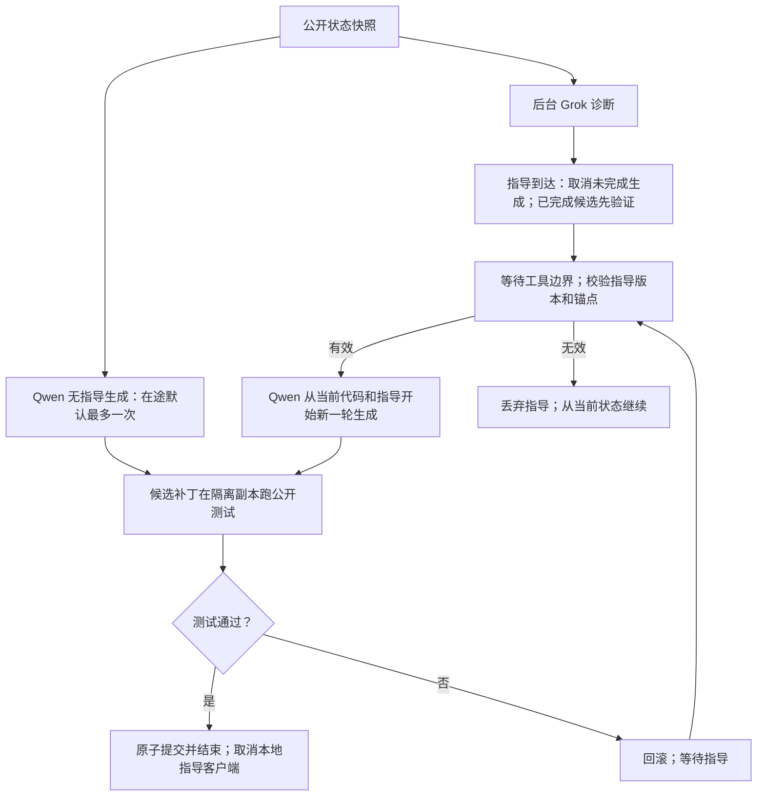

# 异步调度的工程修复

本次只调整执行调度、验证时机和进程清理；信息论门控与编码实现保持不变。实验使用固定请求时点、完整指导字段，Qwen 每次生成固定 seed=0。

**当前结论：固定指导的配对测试提速 1.46×；最终真实联网测试没有提速。** 最终联网为 247.79 秒、10/10，历史同步为 228.92 秒、10/10，耗时增加 8.2%。调度已能利用等待时间完成独立修复，但额外生成量和推理延迟波动仍会抵消收益。

## 为什么之前没有明显加速

1. `WorkPlanner` 把修改导师快照中任何已有文件都算作冲突。默认补丁得分为 `0.2 × 0.7 − 0.5 = −0.36`，而等待得分为 0。因此即使模型已经生成正确补丁，也会选等待。回查旧运行，T01、T03、T04、T07 的首个完整无指导候选均能通过公开与隐藏测试，却没有被执行。
2. 即使选中补丁，在线执行也只暂存，直到导师返回才验证，形成了第二道等待屏障。
3. 导师返回时无条件丢弃 proposal，包括刚刚完成的候选；等待期间还会反复生成相同输入的答案。
4. 第一轮修复实测另发现：导师调用报错后，执行器重新进入无指导生成循环。T10 因此重复生成 19 次、耗时 92.81 秒。该失败轨迹保留，没有替换成重试结果。

## 实现

- 导师只读冻结快照，不把共享文件判为并发写冲突。实际补丁仍须唯一旧文本匹配，并通过隔离副本的公开测试才能原子提交。
- 在线候选立即验证，成功就结束任务并取消本地导师客户端；隐藏测试仅在结束后评价，不返回策略。
- 每个在途请求默认最多一个推测 proposal；预算用完后等待外部结果。`run --max-speculative-steps N` 可调，0 表示不推测。
- 指导到达时取消尚未完成的生成，已完成候选先验证。测试正在运行时，指导等待工具边界，不并发修改工作区。
- 推测解码失败仍等待已发出的指导；导师失败则允许当前候选完成，若未解决且请求预算耗尽，以 `guide_error` 结束，不再空转。
- 取消进程组时，即使父进程已退出，也清理忽略 SIGTERM 的后代。取消远端推理是否成功仍不作保证。

环境原有显式暂存／reconcile 接口保留；在线调度不再使用它延后验证。原子多文件补丁、回滚、版本与锚点校验仍然生效。

## 当前算法怎样运行

本轮策略可概括为“同时请求指导与独立尝试，依据实际完成事件切换”。每题先获取公开测试失败的状态，然后冻结快照，立即发起一次 Grok 请求，同时让 Qwen 不依赖指导尝试修复。Grok 只接收请求时的公开状态；Qwen 与测试读取当前状态。

执行器具体按以下规则推进：

1. **候选先完成：**立即运行公开测试。通过即提交；失败保持原代码。默认一次在途 proposal 用尽后等待，不重复调用模型消耗预算。
2. **指导先到达：**取消尚未完成的无指导生成；已经完成的候选保留并先验证。若公开测试正在运行，就等它结束，再融合指导。
3. **融合指导：**版本相同、锚点仍唯一则应用；版本变化但锚点仍有效则重定位；锚点失效时重新测试，已解题就结束，否则丢弃指导。导师消息本身不直接修改代码。
4. **接着生成：**Qwen 读取当前代码、公开反馈和有效指导，从头发起新生成。当前没有把指导注入尚未完成的 token 流，也没有复用被取消生成的推理进度。常驻工作进程只避免重新加载模型权重。
5. **异常与预算：**指导失败时，允许当前候选完成；未解决且请求预算已用完则结束。解码失败可等待已发出的指导。总步数、截止时间和取消清理始终生效。一次在途尝试预算不等于整题只能生成一次；指导被丢弃后的继续执行仍受总步数控制。
6. **评价：**公开测试通过是在线终止条件；隐藏测试在结束后单独执行，只用于报告正确率。

事件循环同时监视 `guide_task`、`proposal_task`、`tool_task`，使用 `FIRST_COMPLETED` 响应真实完成事件。一个工作区只有一个工具任务可以提交修改。10 道题逐题运行；并行发生在单题的指导请求与本地执行之间。本轮用强制一次请求和固定完整指导字段，不根据预测的信息价值决定何时调用或传多少字段。

## 能加速的范围

旧执行的关键路径近似是“导师耗时 + 有指导生成耗时 + 验证”。新执行对能独立修好的题可以在“无指导生成 + 验证”后结束；对必须依赖指导的题，仍保留“导师响应 → 有指导生成”的依赖链。小模型的推测失败或被取消会额外消耗计算，因此必须同时报告时间、成功率和生成量，不能把墙钟缩短当作算力节省。

## 验证口径

模型为 `Qwen/Qwen2.5-Coder-0.5B-Instruct`，revision `ea3f2471cf1b1f0db85067f1ef93848e38e88c25`；CPU float32、4 threads、temperature=0.7、top_p=0.95、max_new_tokens=256。模型常驻，加载不计入逐题耗时。任务固定为 `voi.tasks.T[:10]`，没有更换 seed 或按隐藏测试选择答案。

继续使用此前完整代码输出接口，再机械转换为整个 `calc.py` 的原子补丁；与此前同接口异步实验比较。此前原生 JSON 动作协议的 0/10 结果不混入速度对照。每题最多一次完整的有指导生成，另允许有界推测。

真实联网实验与指导回放实验分开报告。回放组固定上一轮真实 Grok 的完整指导和逐题服务延迟，两组都实际执行 Qwen 推理；按题交替先跑同步或异步，seed 始终为 0。回放结果只能衡量给定指导条件下的调度效果，不代表新的 Grok 联网服务性能。

47 项测试通过，包括提前解题、失败回滚、指导与候选同时完成、验证中收到指导、推测解码失败、导师失败、截止时间取消、无后台任务遗留和忽略 SIGTERM 的子进程清理。编译检查及 CLI 参数检查通过。

## 测量结果

所有时间为逐题端到端耗时之和（秒），包含本地取消清理与提交后的评价，排除模型加载。

| 实验 | 总耗时 | 隐藏测试通过 | Qwen 调用数 | Qwen 生成 tokens（含取消） |
|---|---:|---:|---:|---:|
| 历史真实同步 | 228.92 | 10/10 | 10 | 324 |
| 历史真实异步 | 228.12 | 9/10 | 33 | 1066 |
| 第一轮修复，真实联网 | 198.00 | 9/10 | 32 | 1683 |
| 最终修复，真实联网 | 247.79 | 10/10 | 16 | 830 |
| 配对同步，固定指导回放 | 201.77 | 9/10 | 10 | 308 |
| 配对异步，固定指导回放 | 138.05 | 10/10 | 15 | 911 |

配对组耗时缩短 **31.6%**，速度比 **1.46×**；异步有 5 题在指导返回前完成，发生 10 次在途有效工具执行。需要指导的 5 题，两组实际送给 Qwen 的完整提示文本逐项相同。

最终联网组共有 0 次指导调用错误、4 次本地指导取消。第一轮联网的 T10 指导进程退出码为 1，日志没有保留足够诊断来确定远端错误原因；该轮完整 198.00 秒、9/10 的结果保留在表内。之后修复了错误后的空转路径，并用最终代码重新运行完整 10 题，没有重跑单题挑选答案。

配对异步的生成 token 数是同步的 2.96 倍；这是降低响应延迟的策略，并没有降低本次总生成量。

最终联网的 Qwen 总生成耗时为 228.33 秒，历史同步为 76.44 秒；这些是生成调用的墙钟耗时之和，不是 CPU 工时。额外推测和取消产生的工作量，以及新指导引起的输出长度变化，都会增加这项成本。即使提示和生成代码相同，耗时也有显著波动：

| 无指导生成 | 配对异步生成秒数 | 最终联网生成秒数 | 输出 tokens |
|---|---:|---:|---:|
| T01 | 3.85 | 15.51 | 39 |
| T03 | 2.05 | 10.34 | 20 |
| T04 | 3.22 | 11.96 | 30 |

以上三题逐项核对了提示文本和输出代码，均相同。现有数据不能进一步确定延迟波动来自何种资源因素，因此不能将最终联网变慢全部归因于 Grok 网络，也不能将配对收益直接外推到真实服务。

### 逐题配对

| 题目 | 同步秒数 | 异步秒数 | 同步隐藏结果 | 异步隐藏结果 |
|---|---:|---:|---|---|
| T01 | 22.17 | 3.94 | 通过 | 通过 |
| T02 | 20.08 | 17.32 | 通过 | 通过 |
| T03 | 17.37 | 2.14 | 通过 | 通过 |
| T04 | 19.14 | 3.31 | 通过 | 通过 |
| T05 | 21.57 | 21.69 | 通过 | 通过 |
| T06 | 15.89 | 16.17 | 通过 | 通过 |
| T07 | 20.21 | 4.35 | 通过 | 通过 |
| T08 | 17.62 | 14.04 | 失败 | 通过 |
| T09 | 20.17 | 26.29 | 通过 | 通过 |
| T10 | 27.53 | 28.81 | 通过 | 通过 |

### 结果边界与复现材料

这 10 道题是小规模 Python 修复任务，不能外推为任意仓库或长任务的稳定加速比。真实 Grok 调用的措辞与延迟会变化；提示中的 seed 不控制远端采样。配对组冻结指导以隔离这一变化，但 CPU 推理耗时仍存在波动。T08 的同步失败说明公开测试不足以保证正确，不能把提前通过公开测试当成正确率保证。

- [完整配对数据与提示一致性审计](results_stage2/async-engineering-paired-seed0.3ysyu8_5/comparison.json)
- [配对运行脚本](results_stage2/async-engineering-paired-seed0.3ysyu8_5/run.py)；[汇总脚本](results_stage2/async-engineering-paired-seed0.3ysyu8_5/analyze.py)
- [最终联网运行脚本](results_stage2/async-engineering-final-seed0.j_62ubmc/run.py)；[结果](results_stage2/async-engineering-final-seed0.j_62ubmc/summary.json)
- [第一轮联网失败轨迹](results_stage2/async-engineering-seed0.quo9sirx/T10/episode.json)
- [源码补丁](results_stage2/async-engineering-paired-seed0.3ysyu8_5/source.patch)；[源码 SHA256](results_stage2/async-engineering-paired-seed0.3ysyu8_5/source-manifest.json)；[47 项测试日志](results_stage2/async-engineering-paired-seed0.3ysyu8_5/tests.log)

详细日志保存在当前工作区被 git 忽略的 `results_stage2/` 下；迁移时需要连同脚本引用的历史实验目录一起保存。

## 整理后的数据文件

- [6 组运行汇总 CSV](reports/async_engineering/run_summary.csv)：成功率、总耗时、Qwen 调用数、取消数、生成量、指导错误数。
- [60 条逐题记录 CSV](reports/async_engineering/task_results.csv)：每条记录带来源文件路径，可回查原始轨迹。
- [汇总 JSON 与统计口径](reports/async_engineering/summary.json)。
- [只读聚合脚本](reports/async_engineering/aggregate.py)：在仓库根目录执行 `python reports/async_engineering/aggregate.py`，重新整理已有日志，不调用模型。

原生 JSON 动作协议那轮为 0/10，主要是动作解析失败与截断；它与本报告采用的完整代码接口不同，作为诊断记录保留在 [原生协议实验](results_stage2/async10-vs-sync-seed0.445suS/summary.json)，不混入共同接口的速度比较。
