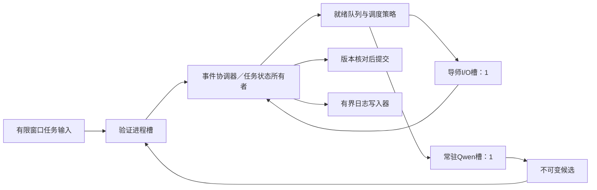

# Stage2 异步优化设计：有界事件驱动流水线与截止时间调度

依据：当前 `voi_async/batch.py` 跨题版、同题版 `runtime.py`、常驻模型后端、验证环境，以及112.873秒真实运行的保存日志。本文件是设计方案；没有部署新调度器或产生新模型测速结果。“最优”以固定执行器/导师额度和固定墙钟内合格完成数为目标，未知任务成功率和服务时延下不声称全局最优。

## 阶段1：剖析和瓶颈

### 1.1 测量结果

| 量 | 112.873秒运行中的数值 | 解释 |
|---|---:|---|
| 本地生成阶段总墙钟 | 112.251秒 | 从 executor_start 到 tool_start，包含模型适配和进程通信，不是纯内核时间 |
| 候选公开验证阶段总墙钟 | 0.358秒 | 12次验证的合计 |
| 执行动作槽以外时间 | 0.263秒 | 包括约0.258秒初始检查及调度/收尾间隙 |
| 执行动作槽占用率 | 99.77% | 生成+验证；不能当成CPU/GPU利用率 |
| 导师6次服务时间合计 | 93.348秒 | 与本地生成重叠，不能再加到112.873秒上 |
| 无指导失败生成 | 35.804秒 | T02约15.73秒、T05约20.07秒；事后失败不等于事前可识别或全部可省 |
| 指导就绪后等待执行 | 平均14.55秒，最大25.70秒 | 多数是本地执行槽正忙，不是通知处理迟缓 |

T05的有指导生成仍耗时26.97秒。导师在0.258至93.608秒之间几乎连续工作，最后约19.26秒主要是执行器排空；单纯继续提高导师占用率没有明确收益。

若保持这12次生成的服务时间不变、仍只有一个执行槽，即使把所有生成以外的时间完全消除，下界也约112.251秒，整批加速至多约1.0055倍。**单靠换异步框架不能合理承诺20%或翻倍加速。** 更大的改善必须来自改变有效工作量、生成耗时、资源配置，或更好地安排截止前完成顺序。

### 1.2 瓶颈与证据等级

| 优先级 | 问题与代码位置 | 影响与证据 |
|---|---|---|
| P0 | 单个长生成占满唯一执行槽；`batch.py:204`起选择下一动作 | 实测主瓶颈。T09指导78.12秒就绪，却等到103.83秒才生成。当前后端不支持保存并恢复未完成生成的KV；取消会损失工作。 |
| P0 | 无指导/有指导路由和固定列表顺序；`batch.py:188`起 | 两次失败独立生成共35.80秒；需减少低产出的长尝试。不能从本轮结果反推规则或声称35.80秒都能消除。 |
| P1 | `_step()`将生成和验证绑成一个资源槽；`batch.py:98` | 生成完成后仍等验证才能派发下一题。当前验证仅0.36秒，但真实仓库测试变长后会成为明显瓶颈。 |
| P1 | 所有题初始测试完成后才启动模型；`batch.py:133` | 批次启动屏障。当前约0.26秒，扩大仓库和测试规模后会增长。 |
| P1 | 控制循环在指导校验分支直接 await 测试；`batch.py:151` | 不会阻塞整个 asyncio 事件循环，但会阻塞这个调度协程处理其余完成事件和补充工作；旧运行未触发，属于代码路径风险。 |
| P1 | 反馈只取 kind=test；`complete_code.py:16`，benchmark FullGuide同样处理 | edit/patch失败反馈存为kind=edit/patch，后续提示可能仍显示最初错误。应携带带候选版本的失败尝试记录，不能把失败候选的错误冒充当前主分支错误。质量/重试影响尚未定量。 |
| P1 | 指导错误直接结束该题，缺少分类恢复；`batch.py:159` | 串行对照T04确实发生CLI错误并失败。恢复可改善合格完成数，但需要时间预算和重试次数限制。 |
| P2 | 仅有1个指导在途限制，没有ready-guidance/WIP/字节背压 | 当前10题内存风险小，扩展后可能积累已返回但无法消化的指导、快照和候选。 |
| P2 | 同步写临时文件、JSONL日志、输出flush；environment与benchmark | 是实际存在的同步I/O路径，但当前微型任务没有测出其为主要耗时。大仓库时应移出调度线程并限制队列。 |
| P2 | 每轮扫描全部任务、收集事件及反复快照序列化 | 10题成本可忽略；大规模时换就绪堆、增量索引和不可变快照。 |

### 1.3 不应误诊的部分

- 推理在常驻独立进程，CLI和测试使用 asyncio 子进程管道；等待远程响应没有同步阻塞整个事件循环。
- `HFProcessModel._lock`保证单一JSONL请求/响应流串行。当前调度器本来最多一个本地生成请求，没有锁争用证据；删除锁会破坏协议而不会创造算力。
- 未采集历史CPU throttling、run queue、上下文切换、锁等待和event-loop lag，不能断言CPU饥饿或切换风暴。
- 检查时cgroup配额是4核，affinity包含5个CPU；实际有效CPU预算应按配额约束，不能按可见CPU数盲目扩线程。历史运行使用Qwen 4线程。
- 原同题异步可在指导到来时取消生成；本地中止保留模型权重，但不能保留已生成工作的可恢复KV。跨题版动作边界切换已避免常规抢占浪费。

### 1.4 可解耦的步骤

独立任务的初始测试可以流式准入；题A指导、题B生成、题C候选验证、题D快照准备可以处于不同阶段。每题内部仍满足“冻结快照→生成候选→隔离验证→版本核对→提交”的依赖。CPU重型测试与CPU推理若共享4核，逻辑并行不保证性能改善，必须受资源准入控制。

## 阶段2：融合方案

### 2.1 核心架构

组合：**事件驱动协调器 + 逻辑Actor状态所有权 + 有界多阶段流水线 + 信用背压 + 截止时间感知列表调度**。



- **Actor思想**：每题只有一个状态所有者。初版可由一个协调器中的TaskState对象实现，不必给每题创建线程或引入分布式Actor框架。工作进程仅接受不可变请求并返回事件；只由所有者更新状态、决定路由和提交。
- **Async/Await事件驱动**：协调器只等待完成事件或定时器。推理、测试、CLI、文件准备均不在其事件处理函数中执行长操作。
- **流水线**：拆分 GENERATING、VALIDATING、GUIDE_WAIT、GUIDE_READY；生成完成立即释放模型槽，验证消耗独立额度。仅可处理其他任务，同题有未验证候选时不能继续基于旧状态生成。
- **响应式信用控制**：下游先预留接收额度，上游才产生候选；指导预取也必须有消费容量。背压限制实际工作，不仅给Python队列设置maxsize。
- **结构化并发/监督**：所有子任务属于本批次生命周期；普通任务错误转为事件隔离处理，全局截止和不可恢复协议错误才触发批次级终止。

默认保留一个常驻小模型进程和一个导师客户端请求槽。没有可迁移KV、没有第二个执行资源时，work stealing无法增加算力，不作为默认机制。

### 2.2 调度目标与策略

目标为最大化 `E[sum_i 1(completion_i <= T) * qualified_i]`。在线只用公开状态与提前校准的估计；隐藏评价用于结束后审计。

每个就绪任务保留：指导状态、公开失败记录、预测剩余生成/验证时间、等待年龄、需要的资源额度。采用以下可解释策略：

1. 在相同质量约束下，优先预计能在截止前完成且单位占槽时间产出更高的动作。若有可信的离线校准，使用预计成功概率/剩余服务时间；没有校准时，用指导状态、公开进展和保守的时长估计，不虚构概率。
2. 加入aging并限制高优先级队列连续服务次数，避免指导任务长期压住其他任务。aging不能保证所有任务都在有限截止前完成，需要单列未服务任务。
3. 导师优先处理已有失败证据且仍有时间消化指导的题；预取只覆盖有限未来工作，不因为导师空闲就无限派发。
4. 分别估计指导就绪工作需要多少本地服务，以及下一次指导还要多久。用消费时间而非仅任务个数调节预取窗口；临近截止时，如果指导返回后也来不及生成和验证，则不启动该请求。
5. 无指导尝试尽量选择短、成功证据较强的题以填充导师等待窗口。不要用本轮隐藏结果或事后失败标签挑题。
6. 默认保持动作边界切换；简单地把当前26秒生成取消并重新开始，可能让合格吞吐更差。若后端未来能原生保存/恢复KV，再实验带最小时间片和切换成本模型的抢占，不把现有SIGUSR1中断误称为暂停恢复。
7. 可以设置一个有严格上限的“等待即将就绪短任务”的可选策略，但默认关闭。T09指导到达时T05已在生成，单纯短任务优先无法解决该次等待。为预测中的短任务短暂保留槽位，可能改善90秒时的完成数，却增加整批makespan；必须按用户指定的时间预算验证，不能声称二者总同时改善。

调度策略是候选启发式，需要与当前固定指导优先/FIFO比较。队列重排主要改变完成曲线；若总工作量和串行服务时间不变，它通常无法显著缩短执行器已满载的整批时间。

### 2.3 算法伪代码

```text
initialize bounded task states and queues
initialize credits: executor=1, guide_client=1, validator=1
initialize candidate_WIP=2, advice_WIP=3, active_tasks=W
# W、候选及指导窗口是初始实验参数，按CPU/内存和时长分布调整
prewarm model; start accounted batch clock

within supervised batch scope:
    pump()  # 启动有限初始检查，首题就绪后即可启动流水线
    while tasks remain and clock < deadline:
        event = await next_completion_or_retry_timer(deadline)
        owner = task_state[event.task_id]
        if duplicate_completion(event): continue

        if event belongs to expired attempt/version:
            discard result; release its remaining reservations
        else if event == INITIAL_CHECK_DONE:
            owner.mark_ready_or_already_solved(event)
        else if event == GUIDANCE_DONE:
            owner.validate_and_store_guidance(event)  # 纯状态/协议检查
            # 如需工具验证，入验证队列，不能在此await测试
        else if event == GENERATION_DONE:
            release executor credit
            enqueue immutable candidate using pre-reserved validation WIP
            owner.state = VALIDATING
        else if event == VALIDATION_DONE:
            if public_pass and base_version/attempt still current:
                owner.commit_atomically(); mark submitted
            else:
                retain previous state
                record candidate-specific failure
                choose NEED_GUIDE / READY / TERMINAL under attempt budget
            release candidate WIP
        else if event == OPERATION_FAILED:
            classify, preserve state, schedule bounded retry or fallback
            # 退避用定时事件；不在协调器里sleep

        pump():
            admit ready checks within validator/CPU/WIP credits
            dispatch guide only if advice credit + useful deadline horizon
            dispatch candidate validation when validator and CPU credits allow
            if executor free and a different task is eligible:
                select task by completion value, estimated duration and aging
                atomically reserve executor + candidate WIP + completion slot
                freeze snapshot(version, attempt_id)
                spawn generation worker
            # 所有派发都不阻塞；资源不足就处理下一个完成事件

    stop admitting new work
    cancel and reap local children; process cancellation acknowledgments
    fence stale attempts; discard all uncommitted candidates
    mark unfinished tasks; close logs and report cleanup duration
run hidden quality audit after scheduling, with no feedback to policy
```

逻辑要点：资源租约按operation_id恰好释放一次，取消和完成竞态不能双重返还额度；若完成事件属于旧版本，仍需释放其资源。正常错误在worker边界被捕获为失败事件，避免TaskGroup因一个CLI异常取消全部题目。协调器本身的状态不变量错误可以升级为全局故障。

### 2.4 背压和内存

- 模型生成前预留候选额度，额度覆盖GENERATING、等待验证、VALIDATING整个生命周期。否则“生成完成后才 await 验证队列”仍会积压大候选。
- 初始验证、候选验证和指导验证共享有界验证资源；优先处理已产生的候选，初始检查按窗口渐进加入，防止输入吞掉全部额度。
- 指导WIP覆盖在途请求与返回待用指导；在指导被消费、丢弃或任务终止时释放。客户端在途另限制为1。初始上限3只是可测默认值，不是推导出的最优值。
- 完成事件通道预留容量，容量至少覆盖获准运行的操作；不要让普通日志占满完成通道。调度器从不 await 一个只能由自己消费才能腾出的队列。
- 快照/候选/指导同时设置总字节限制。大仓库用不可变基线+差异表示，候选工作区隔离；不能直接共享可写测试目录。
- 日志使用单独批量写入器和有界缓冲。关键决策日志有预留空间，日志压力通过减少新工作准入传播；故障时标记记录不完整，不能静默丢失并继续声称实验可复查。

### 2.5 异常、恢复和状态安全

| 情况 | 处理 |
|---|---|
| 测试失败/候选无效 | 不改主状态；记录该候选及其公开错误，在固定尝试预算内求助或重试 |
| 指导协议或anchor不适用 | 指导隔离；必要时排队公开验证或重新诊断，不直接写入代码 |
| CLI明确失败 | 区分可重试服务错误与确定性输入错误；可重试错误最多一次退避重试作为初始策略，且预留后续生成/验证时间 |
| 导师超时、远端取消未知 | 本地终止不等于远端取消；记录unknown请求租约。要求真正单远端在途时，在得到终止证据前保守占用额度，其余任务仍可本地推进；仅靠现CLI不能保证远端 exactly-once |
| 本地模型进程退出/协议错位 | 隔离该进程、确认reap后重启并预热；该次启动计入当前批次时间。不能把旧进程遗留响应交给新请求 |
| 全局截止/用户取消 | 停止准入，取消并清理受控进程组，版本栅栏拒绝迟到结果，未验证修改不提交 |
| 重复或乱序完成事件 | operation_id、attempt_id、base_version共同去重；提交与状态转换只在所有者执行 |

反馈恢复应带 `base_version、candidate_id、candidate_diff、validation_result、state_retained`。失败补丁已回滚，提示必须说明错误来自失败候选，而不是当前文件。

### 2.6 CPU、线程与I/O调度

- 协调器保持单事件循环，只处理短状态更新。采用固定长驻推理进程；不把多个 `model.generate()` 塞进默认线程池。
- 当前4核CPU额度下，先测Qwen 3/4线程与1个验证进程的组合。对微型测试，保留4推理线程很可能更好；不能为“预留核”无条件牺牲主要计算阶段。
- CPU密集验证与CPU推理并行可能争用配额和内存带宽。用CPU权重预算限制共同准入；若没有独立算力，验证阶段拆分是架构能力，不是已证实加速。
- 文件物化/日志用有限I/O线程池；CPU重计算用独立进程或已有原生后端。显式设置工作者数量，避免每个任务各自创建线程池导致过量订阅。
- 当前模型是CPU float32。GPU、不同精度或其他推理引擎可单列实验，但属于资源/后端改变，不能与纯调度收益混为一谈；同质量需重验。
- CLI启动、认证检查、网络和服务端思考当前合并在service time内。只有分段观测后才能判断换持久API连接的收益，不能直接把全部远程时间叫网络浪费。

## 预期效果与验证

### 性能边界

对固定工作量、资源独立的理想模型：

`T_batch >= max(W_executor/C_executor, W_guide/C_guide, W_validation/C_validation, critical_path)`

实际还包含启动、尾部排空和资源争用。当前c_executor=c_guide=1，W_executor约112.251秒、W_guide约93.348秒。

| 改动 | 当前10题的合理预期 | 大规模/长测试场景 |
|---|---|---|
| 消除调度空隙、初始屏障、重叠验证 | 保持同样生成时，理想上限约省0.62秒；实际更少 | 可明显缩短准备/验证对模型的阻塞，前提是有可用资源 |
| 短任务/截止时间感知调度 | 可改善某些时间预算下Q(T)和排队延迟；整批时间未必更短 | 更适合混合长短任务，但需防止长任务饥饿 |
| 更好的求助路由与带版本反馈 | 有机会减少低产出生成和失败后的重复工作 | 是改变总服务需求的主要方向，尚无可信百分比 |
| 异常隔离与有界恢复 | 可能减少因单次CLI错误丢失的题数 | 更稳定；重试也会消耗截止时间，需预算 |
| WIP/字节背压、状态所有权 | 当前主要是可靠性与可扩展性改善 | 活跃中间状态受窗口约束；不是免费降低每题状态大小 |

敏感性计算（不是实测预测）：若同样工作对应的本地生成服务需求减少10%，资源下界变为101.03秒；减少20%时，本地需求约89.80秒，但导师93.35秒成为更大的资源下界。真实总时间还受依赖和排空约束，不能把下界写成预计完成时间。

### 分阶段落地与测量

1. **先测量**：原生记录decision/node调用、生成和验证分段、指导就绪队列、在途/WIP字节、事件循环lag、CPU throttling、RSS和取消确认。D_shape用于检查控制路径变化，不能替代质量与吞吐。
2. **拆分流水线**：先保持现有路由顺序和模型设置，移除初始全局屏障、控制循环中的验证await，建立单所有者提交与资源额度。这样才能单独评估工程并行收益。
3. **再改策略**：独立加入反馈修复、时长排序、aging、有限预取、受限恢复；避免一次更改多个因素后无法归因。固定seed，不根据这10题结果挑参数。
4. **扩大任务**：覆盖短/长生成、短/长验证、服务失败及迟到指导，使用更多代码任务和真实仓库。离线估计只用训练/校准任务，隐藏评价不回流在线。
5. **验证口径**：主指标仍为相同墙钟预算内的合格完成数Q(T)，并报告最终质量、完成时间分位数、资源上限与错误数。重复真实调用估计延迟波动；固定轨迹重排只作诊断，单列为模拟结果。冷启动/清理/隐藏审计的计时规则各组一致。

优先实现顺序：明确反馈与测量 → 阶段拆分和信用背压 → 可解释的截止时间调度 → 根据数据决定是否值得投入生成可恢复后端。当前最重要的是把满载的执行槽用于更可能在预算内形成合格结果的工作。

原始分段数据及复现：`reports/async_design/profile.json`、`reports/async_design/profile.py`。脚本只分析历史日志，不调用模型。
